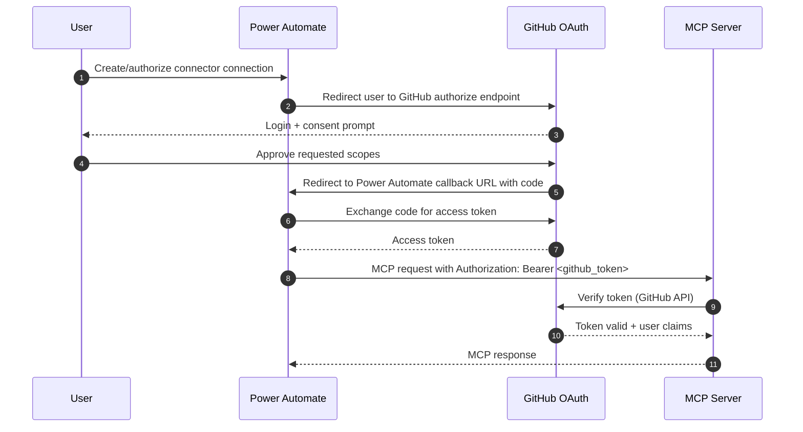
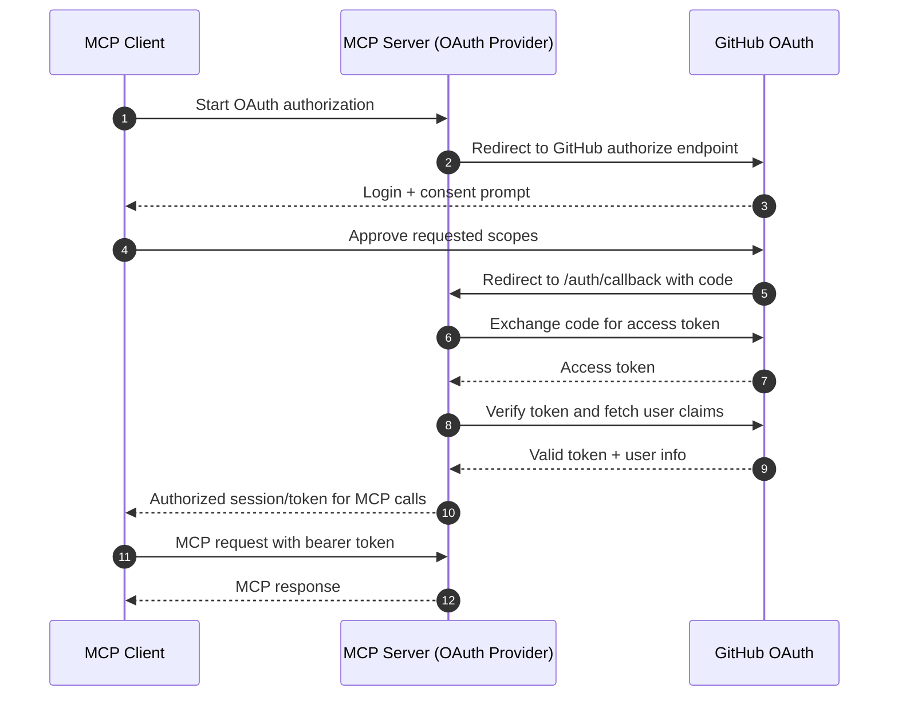

# OAuth Callback Workflows

This document shows two callback patterns:

1. Power Automate custom connector OAuth flow (Power Automate owns callback)
2. Native MCP server OAuth flow (server owns callback)

## Workflow 1: Power Automate Owns the Callback URL

In this model, GitHub redirects back to Power Automate. The MCP server only receives bearer tokens on tool calls.

### Callback URL used

- Power Automate generated Redirect URL (from connector Security tab after Save/Update)

### Notes

- GitHub callback never returns to MCP server in this flow.
- MCP server still validates incoming GitHub bearer token.

## Workflow 2: Native MCP Server OAuth Callback

In this model, the MCP server hosts OAuth routes and receives callback directly.

### Callback URL used

- https://your-domain/auth/callback

### Notes

- The MCP server owns authorization and callback handling in this flow.
- Use this when clients authenticate directly against MCP OAuth endpoints.

## Choosing Between the Two

- Use Power Automate callback flow when Power Automate custom connector is the primary integration.
- Use native MCP callback flow when your clients authenticate directly with MCP OAuth endpoints.
- If both are needed simultaneously, create separate GitHub OAuth apps (one callback URL each).
